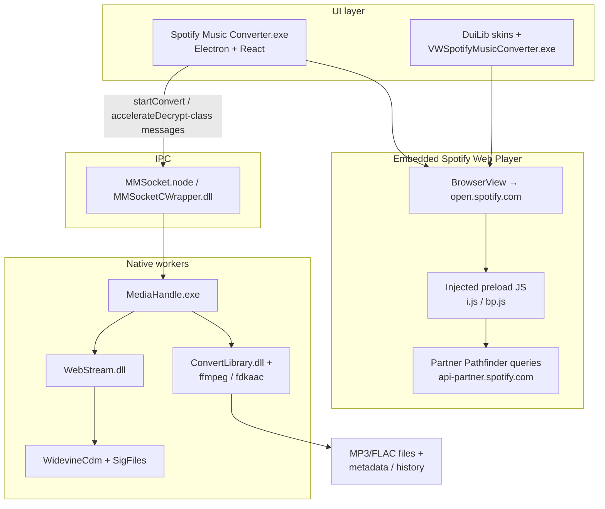

# ViWizard Spotify Music Converter — Architecture Analysis and Terms Conflict Review

**Document type:** Research / forensic inventory (read-only observation of a local install)  
**Subject:** ViWizard Spotify Music Converter **4.0.2**  
**Install path observed:** `C:\Program Files (x86)\Viwizard Spotify Music Converter`  
**Analysis date:** 2026-08-23  
**Authoring context:** HuntingSzn Music Scripts (`sp-dl` design constraints)

> **Scope and limits**
>
> - This document describes **what was observed** in a locally installed commercial application (file inventory, package metadata, user settings, readable preload scripts, logs, and resource layout).
> - It does **not** provide DRM keys, Widevine license acquisition steps, token-extraction recipes, patch instructions, or an operational guide for reproducing protected-stream decryption.
> - Claims are labeled **Observed**, **Inferred**, or **Unknown**. Inferred claims cite the evidence that supports the inference.
> - Personal paths, registration codes, session tokens, and concrete track histories are **redacted** where they appeared in local artifacts.
> - Part II cites public Spotify and U.S. Copyright Office materials. It is **not legal advice**. Terms of Service change; verify primary sources before relying on any clause.

---

## Table of contents

1. [Methodology](#1-methodology)
2. [Part I — How ViWizard works](#part-i--how-viwizard-works)
3. [Part II — Why the protected-stream workflow conflicts with Spotify’s terms](#part-ii--why-the-protected-stream-workflow-conflicts-with-spotifys-terms)
4. [Appendix A — Source appendix](#appendix-a--source-appendix)
5. [Appendix B — Behavior-to-clause matrix](#appendix-b--behavior-to-clause-matrix)
6. [Appendix C — Relation to this repository’s `sp-dl`](#appendix-c--relation-to-this-repositorys-sp-dl)

---

## 1. Methodology

### 1.1 What was examined

| Artifact class | Location (typical) | Purpose |
|----------------|--------------------|---------|
| Install root | `C:\Program Files (x86)\Viwizard Spotify Music Converter\` | Executables, DLLs, Electron/Chromium runtime, skins |
| Electron app bundle | `resources\app\` | `package.json`, webpack bundles, preload scripts |
| Native media workers | `resources\native\` | Socket IPC, convert/decrypt workers, codec stack, Widevine CDM folders |
| Per-user config | `%AppData%\Roaming\ViWizard Spotify Music Converter\` | Settings, task DB, history, logs, cache |
| Registry product keys | `HKCU\Software\ViWizard\97520` (product id also in updater config) | Licensing / product identity |

### 1.2 What was *not* done

- No decompilation of proprietary DLLs/EXE beyond reading publicly visible strings and file names.
- No extraction or dumping of Spotify session cookies, bearer tokens, or CDM license blobs.
- No runtime debugging of decrypt callbacks or key material.
- No redistribution or copying of ViWizard binaries into this repository.

### 1.3 Evidence grades

| Grade | Meaning |
|-------|---------|
| **Observed** | Directly present as a file, readable config/JSON, log line, or package metadata. |
| **Inferred** | Reasonable architecture conclusion from strings, IPC message names, component names, and workflow logs — not a line-by-line code proof. |
| **Unknown** | Behavior that is proprietary, obfuscated, or not confirmed without unsafe reverse engineering. |

---

# Part I — How ViWizard works

## 2. Product snapshot

| Field | Value | Grade |
|-------|-------|-------|
| Product name | Spotify Music Converter / ViWizard Spotify Music Converter | Observed (`package.json`, `Setting.json`) |
| Version | `4.0.2` | Observed (`resources\app\package.json`) |
| Electron app name | `spotify-music-converter` | Observed |
| Vendor | ViWizard (TunesKit lineage also visible via `TTHelper64.exe`) | Observed / Inferred |
| Product id (updater) | `97520` | Observed (`app-update.yml` / registry pattern) |
| Approx. install size | ~470 MB / ~900+ files | Observed (inventory scale) |
| Chromium/Electron marker | `version` file reports Chromium-style build (`34.5.8+wvcus` class) | Observed |

**Why so large?** The install is not a thin script: it ships a full Chromium/Electron shell, UI skins, native Win32 helpers, a multi-codec ffmpeg/AAC/FLAC stack, socket IPC natives, and Widevine CDM folders. That footprint is characteristic of “embedded web player + native decrypt/convert pipeline” products, not of metadata+search downloaders.

---

## 3. Component inventory

### 3.1 Top-level executables and libraries

| Component | Path (under install root) | Role |
|-----------|---------------------------|------|
| Electron host | `Spotify Music Converter.exe` | Main GUI / Chromium shell |
| Native Spotify host | `VWSpotifyMusicConverter.exe` | Native companion process (Spotify-oriented strings / WebSocket / media) |
| TunesKit helper | `TTHelper64.exe` | Shared product-family helper |
| Convert engines | `ConvertLibrary.dll`, `ConvertLibrary64.dll` | Transcode path (FLAC/faac-class symbols historically associated) |
| Stream layer | `WebStream.dll` | Audio web/stream handling (OpenSSL / stream-related strings) |
| UI framework | `DuiLib.dll` + `skin\` | DirectUI XML skins (native dialogs) |
| Audio device | `MMAudioDev.dll` | Native audio device layer |
| Helper | `HelperLibrary.dll` | Shared native helper |
| Updater | `WinSparkle.dll` | Auto-update |
| Chromium runtime | `ffmpeg.dll`, `libEGL.dll`, `libGLESv2.dll`, `*.pak`, `icudtl.dat`, etc. | Standard Electron/Chromium bundle |

**Grade:** Observed (file names + sizes + package metadata). Internal algorithms inside DLLs: **Unknown**.

### 3.2 Electron application bundle

| Path | Notes |
|------|-------|
| `resources\app\package.json` | `main: .webpack/main`, version `4.0.2` |
| `resources\app\.webpack\main\index.js` | Obfuscated main-process orchestration |
| `resources\app\.webpack\renderer\...` | React UI windows (main / browser / loading) |
| `resources\app\.webpack\main\preload\spotify\` | Spotify injectors (`i.js`, `bp.js`, …) — partially readable |
| `resources\app\.webpack\main\preload\{netflix,hulu,deezer,tidal,...}\` | Multi-service “JM” framework skins |
| `resources\app\node_modules\ffi-napi\` etc. | Node FFI into native libraries |
| `resources\app-update.yml` | Remote version check (`api.viwizard.com`, `pid=97520`) |

**Grade:** Observed. The presence of many non-Spotify preload folders strongly suggests a **shared streaming-downloader platform** with Spotify as one skin (**Inferred**).

### 3.3 Native media pipeline (`resources\native\`)

| Component | Role (from names / strings / layout) |
|-----------|--------------------------------------|
| `MMSocket.node`, `MMSocketCWrapper.dll` | Socket IPC between Electron and workers |
| `MediaHandle.exe` | Decrypt/convert worker (`StartDecryptConvert`-class symbols reported in inventory) |
| `NodeRT.exe` | Helper runtime for stream / crypto-adjacent work |
| `MMCodec.dll`, `AEEngine.dll`, `VEEngine.dll` | Shared codec / media engines |
| `avcodec-*.dll`, `avformat-*.dll`, … | ffmpeg-family transcoding stack |
| `fdkaac.dll` | AAC encoding |
| `yt-dlp.exe` | Bundled general downloader (non-Spotify sources possible) |
| `WidevineCdm\<version>\` + `SigFiles\widevinecdm.dll` | Widevine CDM binaries / signed copies |

**Grade:** Observed inventory. Exact decrypt callback wiring: **Inferred** from component names + IPC message names + product behavior. Key handling internals: **Unknown**.

### 3.4 Per-user data

| Artifact | Typical path | Contents |
|----------|--------------|----------|
| Settings | `%AppData%\Roaming\ViWizard Spotify Music Converter\com.viwizard.spotify\Setting.json` | Output dir, format, bitrate, trial duration, backup prefs |
| Task queue | `...\com.viwizard.spotify\db.json` | Download/convert task records |
| History | `...\History.dat` | Completed conversions (XML-like records with Spotify URIs and output paths) |
| Logs | `...\logs\main-YYYYMMDD.log` | UI/Main event stream |
| Cache | `...\Cache\spotify_mediainfo_*` | Metadata caches |
| Spotify web session | Chromium profile under Roaming (IndexedDB for `open.spotify.com`, etc.) | Logged-in web player state |

**Observed settings schema (redacted personal paths):**

```json
{
  "config": {
    "app": {
      "output_dir": "<REDACTED_DOWNLOADS>",
      "output_file_name": "{Title}",
      "output_folder_name": "{Playlist}",
      "audioOutputFormat": "MP3",
      "audio_samplingrate": 48000,
      "audio_bitrate": 256,
      "max_download_count": 1,
      "trialDuration": 30
    },
    "backup": {
      "auto": true,
      "output_dir": "<REDACTED_DOCUMENTS>\\ViWizard Spotify Music Converter\\Spotify Library Backups"
    }
  }
}
```

`trialDuration: 30` is consistent with trial-limited conversion length (seconds) in this product class (**Inferred** from config + product marketing pattern; exact enforcement: **Unknown** without runtime proof).

---

## 4. High-level architecture



**Grade:** Architecture diagram is **Inferred** from component layout + readable preload/IPC names + logs. Boxes labeled Widevine / decrypt are present as **binaries and product behavior**, not as a published open algorithm.

---

## 5. End-to-end workflow (user-visible + observed internals)

### Phase A — Launch and authentication

1. User starts `Spotify Music Converter.exe` (**Observed**).
2. Electron creates a BrowserView / foreground view loading Spotify’s web player (`open.spotify.com`) (**Observed** in logs/preload references).
3. User logs into Spotify inside that embedded browser. Session material lands in the Chromium profile under Roaming (**Observed** profile directories; contents not inspected for secrets).

### Phase B — Metadata and queue building

4. User pastes/drops Spotify track, album, or playlist URLs (**Observed** UI copy + logs such as drop/download media events).
5. Preload scripts query Spotify partner/web APIs (Pathfinder-style GraphQL persisted queries; playlist/rootlist endpoints) using the authenticated web session (**Observed** in readable `bp.js` / related preload patterns; exact query hashes change over time).
6. Tasks are stored in `db.json` with fields such as media id, Spotify URI (`spotify:track:…`), artists, album, playlist grouping, and status (**Observed** schema patterns).

### Phase C — Convert / download

7. On Convert, the main process talks to native workers over MMSocket (**Observed** IPC module names; message names like `startConvert` / `accelerateDecrypt` reported in main bundle strings).
8. The product plays or otherwise drives track audio through the embedded player path while native components handle stream acquisition/processing (**Inferred** from injectors that call player APIs + presence of decrypt/convert workers).
9. Widevine CDM folders and signed CDM copies are present beside the media pipeline (**Observed**). Their presence, together with decrypt-oriented worker symbols, is the strongest architectural signal that protected streams are being unlocked outside Spotify’s normal offline/app-controlled path (**Inferred**).
10. `ConvertLibrary` + ffmpeg-family DLLs write user-chosen formats (MP3/FLAC/etc.) into `output_dir`, often organized by playlist folder templates (**Observed** settings + history paths).
11. History records completed items with Spotify URI → output file mapping (**Observed** `History.dat` pattern).

### Phase D — Licensing, updates, backups

12. Registration UI and registry product keys gate full features (**Observed** skins + registry product id pattern).
13. WinSparkle / `app-update.yml` check ViWizard’s API for updates (**Observed**).
14. Optional library backup exports playlist metadata under Documents (**Observed** backup settings).

---

## 6. Readable preload behavior (high level, non-operational)

Readable Spotify preload scripts are important because they show **how the app instruments the official web player**, not because they alone decrypt audio.

Typical responsibilities observed in this class of injectors:

| Concern | What the scripts appear to do | Grade |
|---------|-------------------------------|-------|
| Access token discovery | Read web-player React/internal state for bearer tokens used against partner APIs | Observed pattern / Inferred detail |
| Player control | Call web player APIs to play URIs, read play state, transfer devices | Observed pattern |
| Catalog expansion | Hit Pathfinder / playlist APIs to list tracks for albums/playlists | Observed pattern |
| Bridge to native | Surface events/metadata to Electron main → MMSocket → MediaHandle | Inferred |

**Critical distinction:** Metadata and playback control are not the same as producing a permanent unprotected audio file. The **native + CDM** side is where protected content becomes a transferable file. That side remains proprietary and is **not** documented here as a procedure.

---

## 7. Configuration, formats, and UX features worth noting

From `Setting.json` and preferences skins:

| Feature | Observed default / option | Relevance |
|---------|---------------------------|-----------|
| Output format | MP3 (also FLAC-class options in UI) | User-facing parity for a compliant tool |
| Sample rate / bitrate | 48000 Hz / 256 kbps in observed settings | Transcode prefs |
| Naming | `{Title}` file, `{Playlist}` folder | Template-based naming |
| Concurrency | `max_download_count: 1` | Queue serialization |
| Trial limit | `trialDuration: 30` | Commercial gating |
| Auto update | enabled | Product maintenance |
| Library backup | Documents path | Metadata export feature |

These UX elements (URL ingest, queue, format, naming, history) are **replicable in spirit** without copying DRM machinery.

---

## 8. Failure modes and install quirks

| Observation | Implication |
|-------------|-------------|
| Missing `RunExternalApp.node` referenced in some logs | Install/update incompleteness; external-helper path may fail |
| Obfuscated main webpack bundle | Harder to audit; encourages inference from periphery |
| Multi-service preloads | Shared platform; Spotify-specific logic is only one adapter |
| Large Chromium + CDM footprint | Performance/disk cost; antivirus may flag CDM/helper binaries |

---

## 9. What is proprietary vs. commodity

| Layer | Commodity? | Notes |
|-------|------------|-------|
| Electron + React UI | Commodity pattern | Not unique to ViWizard |
| Embedded `open.spotify.com` | Uses Spotify’s site | Subject to Spotify ToS |
| ffmpeg / AAC / FLAC encode | Commodity codecs | Licensing still matters for redistribution |
| MMSocket + MediaHandle decrypt pipeline | Proprietary | Core product differentiation |
| Widevine CDM binaries | Google-licensed components | Redistribution/use heavily restricted |
| Registration / trial | Proprietary commercial layer | Unrelated to open tools |

---

## 10. Summary of Part I

ViWizard Spotify Music Converter is a **hybrid Electron + native** application that:

1. Embeds Spotify’s web player and instruments it for login, metadata, and playback control.
2. Queues Spotify URIs and associated metadata.
3. Hands work to native workers that sit beside **Widevine CDM** components and decrypt/convert-oriented modules.
4. Transcodes to ordinary files (MP3/FLAC/etc.) under user-chosen folders.
5. Persists settings, history, and optional library backups.

The **user-visible workflow** (paste Spotify link → get tagged files) is simple. The **implementation** is not: it is a large, DRM-aware media pipeline. Replicating the UX is feasible in a lightweight script; replicating the protected-stream acquisition path is exactly what this repository refuses to do.

---

# Part II — Why the protected-stream workflow conflicts with Spotify’s terms

## 11. Framing: contract vs. statute

Three different questions are often collapsed into one. Keep them separate:

| Question | Domain | What it answers |
|----------|--------|-----------------|
| Does this violate Spotify’s **user** Terms of Use? | Contract (user ↔ Spotify) | Whether the account/use is out of policy |
| Does this violate Spotify’s **Developer** Terms/Policy? | Contract (developer ↔ Spotify) | Whether API/SDK usage is out of policy |
| Does this violate **copyright / anti-circumvention law** (e.g. U.S. 17 U.S.C. §1201)? | Statute | Whether circumvention itself may be unlawful, independent of ToS |

A Terms breach can exist without a court having ruled on a particular statute claim, and vice versa. This Part focuses first on **clear contractual conflict**, then sketches statutory risk at a high level **without legal advice**.

Primary sources accessed around **2026-08-23**:

- Spotify Terms of Use / legal hub: https://www.spotify.com/legal
- Spotify Developer Terms: https://developer.spotify.com/terms
- Spotify Developer Policy: https://developer.spotify.com/policy
- Spotify Compliance Tips: https://developer.spotify.com/compliance-tips
- Widget / Embeds terms (related “no ripping” language): https://developer.spotify.com/documentation/embeds/terms
- U.S. Copyright Office §1201 materials: https://www.copyright.gov/1201/ and 2024 cycle https://www.copyright.gov/1201/2024/

---

## 12. What Spotify grants users (and what it does not)

Spotify’s Terms of Use describe access to a **personalized streaming service** and Content. In substance (verify live text):

- Users receive **limited, non-exclusive, revocable permission** for **personal, non-commercial** use of the Spotify Service and Content (“Access”).
- Software and Content are **licensed, not sold**.
- Users must **not redistribute, sell, or transfer** the Service or Content.

**Implication for converters:** Paying for Premium buys **access under Spotify’s rules**, including Spotify’s own offline mode where available. It does **not** grant ownership of transferable unprotected audio files extracted by third-party tools.

Premium “downloads” in the official apps are best understood as **conditional, app-controlled offline caches**: they remain inside Spotify’s client, tied to subscription state, device limits, and DRM/access controls. They are not equivalent to “I bought an MP3 store file.”

---

## 13. User Terms themes that conflict with ViWizard-class converters

Exact wording varies by locale and revision. The recurring prohibited themes in Spotify’s user-facing legal documents (Terms / User Guidelines / related service terms) include:

1. **Copying / ripping / recording / transferring** Content outside permitted use.
2. **Circumventing technology** used to protect Content or the Service.
3. **Reverse engineering / modifying** the Service beyond narrow legally required interoperability cases.
4. **Moving cached Content** from an authorized device/context to another via unauthorized means.
5. **Redistributing** Content.

### Mapping to observed ViWizard behavior

| Observed / inferred behavior | Conflict theme | Grade |
|------------------------------|----------------|-------|
| Produce permanent MP3/FLAC files from Spotify catalog streams | Copying / ripping / making permanent copies | Strong contractual conflict (**Inferred** from product purpose + output files) |
| Bundle/use Widevine CDM beside decrypt/convert workers | Circumventing protective technology | Strong contractual conflict (**Inferred** from CDM inventory + decrypt worker naming) |
| Instrument web player / hook internal tokens | Unauthorized access method; reverse engineering / modification of Service client surfaces | Contractual conflict (**Observed** injector pattern) |
| Accelerate decrypt / native decrypt pipeline outside Spotify app offline mode | Circumvention + permanent copy | Contractual conflict (**Inferred**) |
| Commercial trial/registration product sold to enable the above | Facilitating prohibited use at product scale | Contractual conflict for operator/vendor; user still bound by Spotify Terms when using it |

---

## 14. Developer Terms and Policy (even clearer on “stream ripping”)

Spotify’s Developer Terms and Developer Policy are explicit that the Platform must not be used to facilitate **stream ripping** or functionalities that make it easier for users to **capture or make permanent copies** of Spotify Content.

Related developer restrictions (summarized; verify live docs):

| Restriction | Relevance |
|-------------|-----------|
| No facilitating stream ripping / permanent copies | Directly targets converter-class products |
| Local caching only as strictly necessary and temporary (metadata/art exceptions; sound recording caching limited) | Permanent library export of full tracks is out of scope |
| Conditional Downloads of sound recordings only for Premium via Spotify’s own offline model | Third-party “offline MP3” is not Conditional Download |
| Cooperation against ripping | Spotify reserves the right to pursue violations |
| Metadata/cover art rules for streaming SDAs | Even metadata use is constrained when tied to unauthorized playback/copy flows |
| No content-saving functionality (also restated in Widget/Embeds terms) | “Save song to disk” features are forbidden in platform integrations |

**Compliance Tips** reinforce that streaming-related SDAs have special rules and that policy violations can lead to suspension or permanent revocation of platform access.

### Does ViWizard even use the official Developer Platform?

Often these products primarily abuse the **consumer web player** rather than a registered Spotify Developer app. That does **not** make the behavior compliant. It means:

- They may bypass Developer Policy *as a registered SDA*, while still violating **user Terms**.
- If they also call partner/web APIs with scraped tokens, they still sit outside authorized developer use (**Inferred** for ViWizard-class injectors).

---

## 15. Clause-style walkthrough (behavior → “why it breaks ToS”)

### 15.1 Permanent file export

**Behavior:** Queue Spotify tracks → write `Title.mp3` under a user folder.  
**Why it conflicts:** Spotify Access is streaming/licensed use, not a grant to create enduring redistributable copies. Developer Policy explicitly forbids facilitating permanent copies / stream ripping.  
**Evidence link:** Product output + history mapping Spotify URI → file path (**Observed**); Policy “stream ripping” language (**Observed** public docs).

### 15.2 Circumvention of protective technology

**Behavior:** Native pipeline adjacent to Widevine CDM folders; decrypt/convert worker naming.  
**Why it conflicts:** User Terms prohibit circumventing technology that protects Content. Decrypting access-controlled streams to dump clear audio is the archetypal circumvention pattern.  
**Evidence link:** `WidevineCdm\` inventory (**Observed**); decrypt-oriented workers (**Observed** names / **Inferred** role).

### 15.3 Token / player instrumentation

**Behavior:** Injected scripts read web-player internals (token/player API hooks).  
**Why it conflicts:** Unauthorized access methods, modification of Service surfaces, and use of credentials/tokens outside Spotify’s intended client flows. Developer docs require official OAuth for platform access; scraping `_accessToken` from React state is not an approved flow.  
**Evidence link:** Preload patterns (**Observed**); Developer auth guidance (**Observed** public docs).

### 15.4 “But I have Premium”

Premium authorizes **Spotify’s** offline features and higher-quality streaming under Spotify’s control. It does not authorize third-party tools to:

- strip DRM,
- write unrestricted files,
- or build a personal MP3 store from the catalog.

Official offline downloads remain **Conditional Downloads** in Spotify’s developer vocabulary: time-limited, Premium-tied, app-mediated — not transferable exports.

### 15.5 Metadata-only vs. audio dump

Using Spotify metadata through the **official Web API** under Developer Terms (with attribution, caching limits, no ML training misuse, etc.) can be legitimate for many apps.  
ViWizard-class converters are not “metadata tools”; metadata is a **means** to drive ripping. The conflict is primarily the **audio permanence + circumvention**, not the mere display of a track title.

---

## 16. Contractual consequences (what Spotify can do under its contracts)

Without predicting outcomes in any specific case, the documents themselves contemplate:

| Lever | Typical effect |
|-------|----------------|
| Account suspension / termination | User loses Spotify Access for Terms violations |
| Developer app revocation | Client IDs disabled; API access cut |
| Pursuit of ripping facilitators | Explicit cooperation / enforcement language in developer materials |
| Platform security changes | Spotify periodically hardens developer access (e.g. 2026 Development Mode restrictions blog) which also raises the cost of unofficial clients |

These are **contract and platform-enforcement** consequences. They are distinct from civil/criminal statutory claims.

---

## 17. Statutory anti-circumvention sketch (U.S.) — not legal advice

### 17.1 What §1201 is about

Under U.S. copyright law, 17 U.S.C. §1201 generally prohibits **circumventing a technological measure that effectively controls access** to a copyrighted work. The Copyright Office’s rulemaking materials describe circumvention in terms such as descrambling, decrypting, or otherwise avoiding/bypassing/removing/deactivating/impairing an access control without the authority of the copyright owner.

See: https://www.copyright.gov/1201/ and the 2024 recommendation materials at https://www.copyright.gov/1201/2024/

### 17.2 How this relates to Spotify converters (high level)

| Element | Sketch |
|---------|--------|
| Copyrighted works | Commercial sound recordings on Spotify are copyright-protected |
| Access control | Streaming DRM (e.g. Widevine-class CDM paths) is an access-control technology in ordinary operation |
| Circumvention risk | Tools that decrypt protected streams to produce clear files may implicate §1201 **in addition to** ToS |
| Trafficking risk | Products marketed to bypass DRM can raise additional §1201 concerns around trafficking in circumvention tools |
| Exemptions | Triennial exemptions exist for **specific classes** of works/uses; there is **no** general “personal Spotify MP3 dump” exemption described in the public 1201 materials reviewed for this doc |

### 17.3 Important caution

- **Not every Terms violation is automatically a §1201 violation**, and not every technical decryption is automatically excused by fair use or by owning a Premium subscription.
- Jurisdiction matters (DMCA is U.S.-centric; other countries have analogous anti-circumvention rules).
- This repository treats DRM circumvention as **out of scope** regardless of someone’s personal legal theory.

---

## 18. Why “we’re just converting format” is not a defense under Spotify’s contracts

Format conversion of **files you already lawfully possess as transferable audio** (e.g. a purchased download where the license allows) is different from:

1. accessing Spotify’s protected stream,
2. defeating the protection,
3. writing a new permanent copy.

ViWizard’s architecture shows steps (1)–(3). Calling the UI a “converter” does not change the contractual character of ripping a stream.

---

## 19. Risk summary

| Risk type | Level for ViWizard-class protected-stream export | Notes |
|-----------|--------------------------------------------------|-------|
| Spotify user Terms conflict | High | Permanent copies + circumvention themes |
| Spotify Developer Policy conflict | High if Platform/tokens involved; still high facilitation risk | Explicit anti-ripping language |
| Platform enforcement | Material | Account/API/product disruption |
| §1201 / analogous statutes | Material risk surface | Requires counsel for case-specific advice |
| Copyright infringement (reproduction) | Material risk surface | Separate from ToS; depends on facts |

---

## 20. Compliant alternatives (design constraints adopted here)

| Goal | Compliant approach |
|------|--------------------|
| Use Spotify as a catalog | Official Web API metadata (client credentials / user OAuth as needed) |
| Obtain audio files | Sources that permit downloading under their own terms (e.g. YouTube/SoundCloud via yt-dlp where allowed), or files the user already owns |
| Match quality | Confidence-ranked search (title/artist/duration/version heuristics); reject bad matches |
| Tag like Spotify | Apply Spotify metadata/artwork to the **external** audio file after download |
| Queue/playlist UX | Expand Spotify playlist/album IDs via API; download matched externals |
| Offline listening on Spotify | Use Spotify’s official offline mode |

**Non-goals for this repo:**

- No Widevine CDM bundling
- No Spotify stream decryption
- No token scraping from `open.spotify.com`
- No copying ViWizard binaries, injectors, or native decrypt workers

---

# Appendix A — Source appendix

### A.1 Local artifacts (2026-08-23)

| Source | Use |
|--------|-----|
| `...\Viwizard Spotify Music Converter\resources\app\package.json` | Version / product identity |
| Install root file listing | Component inventory |
| `%AppData%\...\Setting.json` | Output/format/trial settings (paths redacted in narrative) |
| Preload directory layout under `.webpack\main\preload\` | Multi-service + Spotify injector presence |
| `resources\native\` layout | MMSocket, MediaHandle, WidevineCdm, ffmpeg stack |
| Logs / history patterns | Queue and completion workflow |

### A.2 Public primary sources

| Source | URL |
|--------|-----|
| Spotify legal hub / Terms | https://www.spotify.com/legal |
| Developer Terms | https://developer.spotify.com/terms |
| Developer Policy | https://developer.spotify.com/policy |
| Compliance Tips | https://developer.spotify.com/compliance-tips |
| Embeds / Widget terms | https://developer.spotify.com/documentation/embeds/terms |
| §1201 overview | https://www.copyright.gov/1201/ |
| §1201 2024 cycle | https://www.copyright.gov/1201/2024/ |
| Developer access update (2026-02) | https://developer.spotify.com/blog/2026-02-06-update-on-developer-access-and-platform-security |

---

# Appendix B — Behavior-to-clause matrix

| ViWizard-class behavior | User Terms theme | Developer Terms/Policy theme | Statutory sketch |
|-------------------------|------------------|------------------------------|------------------|
| Export permanent MP3/FLAC from Spotify streams | No unauthorized copying/ripping/redistribution | No stream ripping / permanent copies | Reproduction + possible access-control issues |
| Widevine-adjacent decrypt/convert pipeline | No circumvention of protective tech | Facilitating capture of Content | §1201-style circumvention risk |
| Web player injection / token hooking | No unauthorized access / reverse engineering beyond narrow exceptions | Unofficial auth; outside approved OAuth | Computer-access / ToS; not analyzed in depth here |
| Playlist expansion via partner web APIs with session token | Access only as permitted | Platform misuse if treated as SDA | Mostly contractual |
| Sell/trial a converter product | User still bound; vendor facilitates breach | Anti-ripping + cooperation clauses | Trafficking theories possible under anti-circumvention law |
| Official-looking “library backup” of metadata | May be closer to export | Caching/metadata limits still apply | Lower risk if metadata-only and API-compliant |
| Transcode already-owned local files | Generally outside Spotify conflict | N/A | Ordinary format shift of owned files |

---

# Appendix C — Relation to this repository’s `sp-dl`

| ViWizard capability | `sp-dl` approach |
|---------------------|------------------|
| Paste Spotify URL | Yes — parse track/album/playlist |
| Expand to queue | Yes — official Spotify Web API |
| Download Spotify’s protected audio | **No** |
| Find matching audio elsewhere | Yes — YouTube first, SoundCloud fallback |
| Confidence matching | Yes — duration/title/artist/version heuristics |
| Tag with Spotify metadata/art | Yes — mutagen after external download |
| History / resume | Yes — JSON manifest |
| Bundle Widevine / decrypt workers | **No** |
| Electron GUI | **No** — CLI / scripts only |

This research document exists so the architectural reality of ViWizard is understood **and** so the repo’s refusal to copy its protected-stream path is explicit, evidence-based, and durable.

---

*End of document.*
